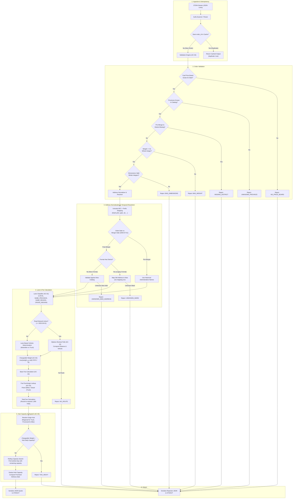

# Delivery Pricing Engine

A high-performance, deterministic logistics delivery pricing, routing, and dispatch engine built in Go. The engine processes incoming delivery orders via JSON streaming over standard input, classifies delivery lanes, calculates base and fuel surcharge fees, computes optimal road routes using Dijkstra's algorithm, and assigns pickup and promised delivery dates subject to daily hub capacity constraints.

---

## Architecture

The engine is structured into modular, decoupled packages designed for high performance, testability, and determinism.



### Core Components

- **`cmd/engine/main.go`**: Command-line entrypoint. Reads newline-delimited JSON from standard input via buffered I/O (`bufio.Scanner` with a 1MB buffer) and streams results to standard output.
- **`internal/engine`**: Pipeline orchestrator. Manages per-order workflow, coordinate validation, lane classification, fee evaluation, dispatch allocation, and memoizes processed orders for idempotency.
- **`internal/normalize`**: Vietnamese administrative text normalizer. Enforces Unicode NFC normalization, trims and collapses duplicate whitespaces, converts to lowercase, and strips standard administrative prefixes (`thành phố`, `thị xã`, `thị trấn`, `huyện`, `phường`, `quận`, `tỉnh`, `xã`, `tp`, `tx`, `tt`, `h`, `p`, `q`, `x`).
- **`internal/data`**:
  - `loader.go`: Ingests and parses all configuration and reference datasets (`fees.json`, `regions.json`, `provinces.json`, `fuel-prices.json`, `capacity.json`, `roads.json`, `mapping.csv`).
  - `board.go`: Generic `BoardLookup[T]` implementing date-effective binary search (`sort.Search`) for temporal configurations (fuel prices, hub capacity limits).
  - `routing.go`: Road graph model featuring Dijkstra's shortest path algorithm with symmetric pair caching for road distance and transit delay calculations.
- **`internal/pricing`**: Implements input validation rules, chargeable weight calculation ($\max(\text{weight\_g}, \lceil \frac{L \times W \times H}{5} \rceil)$), tiered block-based base fees, stepped and capped fuel surcharges, and half-up rounding to the nearest 1,000 VND.
- **`internal/dispatch`**: Thread-safe hub capacity management (`HubState`). Tracks remaining daily capacity per hub and executes rolling forward searches to determine earliest available pickup and promised delivery dates.

---

## How Merger Day is Handled

On **July 1, 2025 (`2025-07-01`)**, administrative reorganization merged several provinces and districts in Vietnam (e.g., Bình Dương merged into Hồ Chí Minh, with its former capital Thủ Dầu Một becoming a ward under Hồ Chí Minh). The engine handles this administrative merger seamlessly:

### 1. Strict Temporal Invariance
All business logic is evaluated relative to the order's `created_at` timestamp against `MergerDate` (loaded from `mapping.csv`):
- **Pre-Merger Orders (`created_at < 2025-07-01`)**:
  - Require the `district` field; omitting it triggers rejection `MISSING_DISTRICT`.
  - Evaluated using pre-merger boundaries. For instance, an order between Bình Dương and Hồ Chí Minh is classified as `SAME_REGION` (base fee 35,000 VND).
  - Capacities are checked against pre-merger hub allotments (e.g., Bình Dương daily capacity = 60,000g).
- **Post-Merger Orders (`created_at >= 2025-07-01`)**:
  - Automatically classified under post-merger boundaries. Deliveries between former Bình Dương and Hồ Chí Minh are now intra-provincial `SAME_PROVINCE` (base fee 26,000 VND).

### 2. Dual Address Ingestion & Seamless Backward Compatibility
To avoid disrupting existing customer integrations or legacy client systems that still supply old addresses:
- **Legacy Format (contains `district`)**: Looked up in `mapping.csv` via composite key `old_province|old_district|old_ward`. If valid, it is automatically converted to the canonical new province and ward. If the combination does not exist, the order is rejected with `UNKNOWN_WARD`.
- **New Format (omits `district`)**: Looked up directly in `NewAddrSet` by `new_province|new_ward`. If unrecognized, rejected with `UNKNOWN_NEW_ADDRESS`.
- **Identical Outcomes**: An old-format address and its corresponding new-format address resolve to identical physical depots, lanes, fees, and delivery schedules.
- **Historical Stability**: Reprocessing pre-merger orders produces the exact historical quote without retroactive price recalculation.

### 3. Physical Depot Continuity for Distance & Routing
Even when Bình Dương became administrative part of Hồ Chí Minh, the physical depot and road network remain anchored to physical reality:
- Addresses record their original depot province (`Depot`).
- Distance calculations and road routing continue to use the underlying geographic depot nodes on the road graph.

### 4. Hub Capacity Transition
- Pre-merger motorbike orders use provincial hubs (`Bình Dương`, `Hồ Chí Minh`).
- Post-merger motorbike orders targeting merged territories transition to the unified hub (e.g., `Hồ Chí Minh` hub capacity increased from 100kg to 150kg to accommodate former Bình Dương volume).

---

## Scale Question Answer

### Challenge
How do we scale this engine from a single CLI process processing orders sequentially from STDIN to a high-throughput, distributed platform handling **millions of orders per day** with sub-10ms latency, high availability, and zero race conditions on hub capacities?

### Proposed Architecture

#### 1. Separation of Concerns: Stateless vs. Stateful Workflows
The pricing workflow cleanly bifurcates into two distinct domains:
1. **Stateless Pricing & Lane Classification** (CPU-bound, highly parallelizable):
   - Input validation, address normalization, date-effective board lookups, chargeable weight, road distance calculation, base fee, and surcharge calculation.
   - Can be served by a stateless tier of Go microservices behind an API Gateway / Load Balancer.
2. **Stateful Capacity Reservation & Dispatch** (I/O and concurrency-bound):
   - Hub capacity checks, slot deductions, and promised date assignment.
   - Requires concurrency control and serializability per hub/date.

#### 2. All-Pairs Shortest Path (APSP) Precomputation
- In Vietnam, there are at most 63 provinces (depot vertices).
- Instead of executing Dijkstra on each request, run **Floyd-Warshall** at startup in $O(V^3) \approx 63^3 = 250,047$ operations (under 5 milliseconds).
- Keep a 2D matrix / flat lookup table in memory. Distance lookups become immediate $O(1)$ operations with zero locks and zero allocations.

#### 3. Distributed Hub Capacity Management
In the single-node engine, capacity is protected by an in-memory `sync.Mutex`. In a distributed deployment:
- **Partitioning / Sharding by `(HubID, Date)`**:
  - Hub capacities are strictly independent across different hubs and different calendar dates.
  - Redis Cluster or PostgreSQL sharded by `hash(hub_id, date)` completely eliminates cross-hub lock contention.
- **Atomic Deduction via Redis Lua Script / PostgreSQL Conditional Update**:
  ```lua
  -- Atomic check-and-decrement in Redis
  local key = KEYS[1] -- "hub:hcm:2025-07-07"
  local weight = tonumber(ARGV[1])
  local current = tonumber(redis.call('GET', key) or 0)
  if current >= weight then
      redis.call('DECRBY', key, weight)
      return 1
  else
      return 0
  end
  ```
- **Two-Phase Reservation (Soft Reserve with TTL)**:
  - When quoting an order during customer checkout, place a 15-minute soft reservation on the capacity slot.
  - If the customer confirms payment, convert to a hard booking; if abandoned or expired, capacity automatically releases back to the pool.

#### 4. Idempotency & Duplicate Order Handling
- Replace the in-memory map with a distributed key-value store (Redis / DynamoDB) storing `order_id -> quote_json` with a 30-day TTL.
- An optional preliminary Bloom Filter can quickly identify novel orders without incurring remote database reads.

#### 5. Dynamic Configuration Updates
- Fuel price boards and capacity schedules are indexed by date (`effective_from`).
- Use a distributed configuration store (Consul, etcd, or Kafka topic) to broadcast updates.
- Worker nodes append new dated entries to their in-memory `BoardLookup` data structures using copy-on-write pointers (`atomic.Pointer[DataStore]`), enabling zero-downtime hot reloading without service restarts.

#### 6. Streaming & Asynchronous Batch Processing
- For real-time checkout: gRPC / REST endpoints achieving p99 < 5ms.
- For bulk B2B batch orders: Kafka message broker with order partitions keyed by `origin_hub`. Consumer groups process orders in parallel without inter-hub synchronization.

---

## How to Run

### Prerequisites
- [Go](https://go.dev/) 1.22 or later installed.
- Bash-compatible shell.

### Build the Project
```bash
go build -o engine ./cmd/engine
```

### Run Tests
Execute all unit tests across all packages:
```bash
go test ./...
```

Execute tests with race condition detection and verbose logging:
```bash
go test -race -v ./...
```

### Run Using `run.sh`
The repository includes an executable helper script `run.sh` that compiles and runs the engine:
```bash
chmod +x ./run.sh
```

#### Example 1: Pre-merger Order (`order-0001`, 2025-06-30)
```bash
echo '{"order_id":"order-0001","created_at":"2025-06-30","weight_g":1500,"from":{"ward":"Phú Cường","district":"Thủ Dầu Một","province":"Bình Dương"},"to":{"ward":"Bến Nghé","district":"Quận 1","province":"Hồ Chí Minh"}}' | ./run.sh
```
**Output:**
```json
{"order_id":"order-0001","status":"quoted","lane":"SAME_REGION","chargeable_g":1500,"base":35000,"surcharge":1050,"total":36000,"distance_km":null,"pickup_date":"2025-06-30","promised_date":"2025-07-02","duplicate":false,"reason":null}
```

#### Example 2: Post-merger Order (`order-0007`, 2025-07-07)
```bash
echo '{"order_id":"order-0007","created_at":"2025-07-07","weight_g":1500,"from":{"ward":"Phú Cường","district":"Thủ Dầu Một","province":"Bình Dương"},"to":{"ward":"Bến Nghé","district":"Quận 1","province":"Hồ Chí Minh"}}' | ./run.sh
```
**Output:**
```json
{"order_id":"order-0007","status":"quoted","lane":"SAME_PROVINCE","chargeable_g":1500,"base":26000,"surcharge":0,"total":26000,"distance_km":null,"pickup_date":"2025-07-07","promised_date":"2025-07-08","duplicate":false,"reason":null}
```

#### Example 3: Running All 22 Worked Examples
To run all 19 blocks (22 worked examples) with independent hub states verified against expected outputs in a single command (Deliverable 3.1):
```bash
./test-examples.sh
# or:
go test -v ./tests -run TestAllWorkedExamples
```

---

## Documentation & Co-Design Records

For the presentation and detailed architectural inspection, please refer to:
- [Deliverables & Expected Outcomes Guide](file:///Users/johnny/Projects/coding-challenges/docs/DELIVERABLES_AND_EXPECTED_OUTCOMES.md): Complete mapping of all AC requirements, 70-point evaluation breakdown, presentation slide guide, and strategy for the 10-minute live demo rule change.
- [1,000,000 Orders Scale Benchmark (AC-09)](file:///Users/johnny/Projects/coding-challenges/docs/SCALE_BENCHMARK.md): Complete performance report, micro-benchmarks, and case study of the $O(N^2) \rightarrow O(N)$ capacity fast-forward optimization (181,676 orders/sec).
- [Technical Decisions & Architecture Decision Records (ADRs)](file:///Users/johnny/Projects/coding-challenges/docs/TECHNICAL_DECISIONS.md): In-depth trade-off analyses on Go selection, pipeline processing, temporal `BoardLookup[T]`, normalization, Dijkstra routing, and candidate-day hub allocation.
- [Human-AI Collaboration Log](file:///Users/johnny/Projects/coding-challenges/docs/COLLABORATION_LOG.md): Full transcript and narrative of the human-AI co-design dialogue, planning approval, Flash worker delegation, permission management, and self-healing test fixes.

